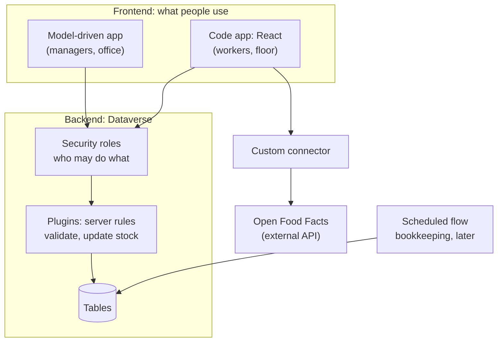

# Frontend and backend on Power Platform

*Power Platform team, QPS · from the ALM lab, 2026-10-25 · draft for team discussion · companion to [Lessons learned](qps-lessons-learned.md)*

## Why this matters to us

Our FAQ agents have one layer: the agent *is* the app. Business apps for other teams have at least two: the **frontend** (the screens people use) and the **backend** (the data and the rules that protect it). Most of what went right in the lab, and most of the mistakes we'd be likely to make, come down to putting each piece of logic in the right layer.

The lab app is a warehouse stock system: managers maintain items in the office, workers pick and restock on the floor. That's close to **site material control** for us: a laydown yard issuing material against a work package, where nobody should be able to issue more than is on hand.

## The one rule

> **The server decides. The screen helps.**

A screen can make an action easy, fill in defaults and show a friendly message. It must never be the only thing deciding whether an action is *allowed*. Data in Dataverse can be changed by many routes besides our app: another app, a flow, an Excel import, the Web API, an agent. A check that lives only in a screen is skipped by all of them.

The lab's specs state it plainly: *"A rule in the browser is not a rule."* In the code app, the spec goes further: **no stock comparison is allowed in the app at all**. If a worker tries to pick 11 when 10 are on hand, the app sends the request anyway, the server refuses it, and the app shows the server's message unchanged.

## The layers in the lab app

| Layer | What it is | In the lab | Owns |
|---|---|---|---|
| **Data model** | Tables, columns, relationships | Location, Item, Transaction, Product | The shape of the data |
| **Security** | Roles and privileges | *Warehouse worker*, *Warehouse manager* | Who can read, create, change or delete which records |
| **Server rules** | Code that runs inside Dataverse on every save | Two C# plugins: "no over-picking" and "stock follows transactions" | What's *allowed*, and what must change *together* |
| **Background jobs** | Work that runs after the save, outside the user's wait | A scheduled cloud flow marks transactions processed | Bookkeeping that must never block or break a user's action |
| **Integrations** | Connectors to outside systems | Open Food Facts custom connector | Talking to the outside world, and the shape of what comes back |
| **Frontend** | Screens | A model-driven app and a code app | Making the work fast and clear: defaults, layout, messages |

Each backend layer is its **own solution** in source control (data model, logic, security, UI, connectors). A schema change can't hide inside a screen change, and each layer can have its own reviewer.

## One pick, end to end

What happens when a worker picks 5 laptops in the code app:

1. **Frontend:** the app checks only that the required fields are filled in, then sends "create a transaction: Outbound, 5, Office Laptop".
2. **Security:** Dataverse checks the worker's role. *Warehouse worker* may create transactions. If it couldn't, the request stops here, whichever app sent it.
3. **Server rule, before the save** (validation plugin, *pre-validation* stage): reads the stock on hand. If 5 is more than what's available, it refuses with `Not enough product in stock. Available: 3, requested: 5.`, and nothing is saved.
4. **The save:** the transaction record is written.
5. **Server rule, inside the save** (stock plugin, *post-operation* stage): subtracts 5 from the item's stock. Steps 4 and 5 are **one database transaction**: if the stock update fails, the transaction record is rolled back too. The data can't end up half-done.
6. **Frontend:** shows "Transaction created" and refreshes the stock figure *from the server*, not by doing the subtraction itself.
7. **Later, in the background:** the scheduled flow marks the transaction processed. If it fails, the pick is unaffected.

The same steps 2–5 run when a manager records the movement in the model-driven app, when a flow creates it, or when someone imports a spreadsheet. **That's the point.**

## What belongs where

| The logic is… | Put it in | Lab example | QPS example |
|---|---|---|---|
| A rule that must **always** hold | Server rule (plugin) | Can't pick more than is on hand | Can't issue more material than is on hand; can't approve a PO above your limit |
| Several changes that must succeed or fail **together** | Server rule, synchronous, inside the save | Transaction saved ⇔ stock updated | Material issued ⇔ yard balance reduced |
| **Who** may do something | Security role | Workers can't delete stock history | Only the project's team sees its bid pricing |
| Work that can happen **later** | Background flow | Mark transactions processed | Notify procurement, sync to the ERP, send a daily digest |
| A **default** or a convenience | Frontend | Transaction date defaults to now; total = qty × price | Pre-fill the project from the user's assignment |
| A **friendly message** | Frontend shows it; the server writes it | The over-pick message, shown unchanged | Approval limit message |
| Talking to an **outside system** | Custom connector | Barcode lookup | Vendor catalog, ERP lookups |

**Quick test:** *if someone changed this data through Excel or the API, would it be a problem that this logic didn't run?* If yes, it belongs on the server.

## Choosing a frontend

| | Model-driven app | Code app | Canvas app |
|---|---|---|---|
| **What it is** | Configured from metadata: forms, views, navigation | A custom web app (React and TypeScript) hosted by Power Apps | A drag-and-drop app built with Power Fx formulas |
| **Best for** | Back-office work on many tables: complete CRUD | Narrow, fast, task-focused screens, often on a phone | Simple task apps built by makers |
| **In the lab** | Managers: every table, form and view | Workers: find an item, pick, restock, scan | Not used |
| **Skills** | Configuration, a little JavaScript | Real web development | Low-code |
| **Cost to us** | Low | High: it's a software project | Low to medium |

The lab used **both** apps, one per persona, over **the same backend**. That only works because neither app owns any rules: two apps can't drift apart in how they enforce stock when neither enforces it.

Code apps are powerful, but they're a web development project, with packages, builds and a toolchain. For us, **model-driven first, canvas for simple task apps, code apps only when the screen really needs it.**

## Choosing a backend tool

The lab used C# plugins. That's the most capable option, and it needs a developer. There are lower-code options for the same jobs:

| Tool | Runs | Good for | Watch out |
|---|---|---|---|
| **C# plugin** (lab) | On the server, during the save, sync or async | Any rule, multi-record consistency | Needs C#, a build and testing |
| **Dataverse business rule**, table scope | On the server, during the save | Simple field rules: set a value, require a field, validate a range | Limited logic; the *form* scope runs only on forms, so pick **Entity** scope for a real rule |
| **Dataverse low-code plug-in** (Power Fx) | On the server | Plugin-like rules without C# | Check its current support status before relying on it |
| **Power Automate cloud flow** | **After** the save, async | Notifications, integrations, bookkeeping | Can't stop a save, and runs later: never use it to enforce a rule |
| **Form script** (JavaScript) | In the browser, on the form | Defaults, calculations, showing or hiding fields | Not a rule: only runs on that form |

**A common mistake to avoid:** using a flow to "enforce" a rule. The flow runs after the bad data is already saved, and it runs only if nothing went wrong.

## External data: the connector pattern

Part of the lab (CP11) added a barcode lookup against Open Food Facts, a public product database:

- **The connector shapes the data.** It adds the header the outside service requires, turns "product not found" into a proper error, and flattens the reply into five simple fields. Every app that uses it gets clean data; none has to know the outside API's quirks.
- **The connector holds no credentials.** The solution carries only a *reference*. Each environment (Dev, Test, Production) creates its own **connection**. For a system that needs a key, the key lives in that environment's connection, never in source control.
- **The outside data is copied into its own table** (Product), separate from our own records (Item), and linked by a lookup. We can refresh or replace the catalog without touching stock.
- **No rollback across steps.** Linking a product is three separate calls: find or create the product, link it to the item, save the image. If the image fails, the first two stand. The spec says so on purpose: each step leaves valid data. *If something must be all-or-nothing, it needs a single server-side operation, not several calls from the screen.*

For QPS, the same pattern would connect to the ERP, a vendor portal or a document system, with a **DLP policy** deciding which connectors may be used alongside business data.

## The contracts between the layers

The frontend and backend meet at a few fixed points. Treat them as interfaces, and review changes to them carefully:

| Contract | Why it matters |
|---|---|
| **Table and column names** | The frontend's typed code is **generated from the data model**. Rename a column and the app stops building, which is good: it fails at build time, not in production. |
| **Error message text** | The server writes it, the screens show it unchanged, and tests check it. The spec calls the message *"part of the interface"*. |
| **Security roles** | The screens are designed for the roles. A button can be hidden for convenience, but **hiding a button isn't security**: the role is. |
| **Connector operations** | The app calls `GetProductByBarcode`, not the raw outside API. The outside API can change while the app stays the same. |

## Gotchas we saw

- **"Required" isn't required everywhere.** Dataverse *business required* is enforced by **forms only**. The Web API and data imports can still save the record without the field. If it truly must be filled, enforce it on the server.
- **Code app calls don't throw errors; they return them.** Each call returns `{ success, error }`. If the code doesn't check `success`, a save the server refused looks like it worked. Review for this.
- **Rules fire on specific events.** The stock plugins run on *Create* only, by design: editing a transaction later never moves stock. Know which events each rule is registered on, and test the ones it isn't.
- **Server rules run as the calling user.** Automation can't quietly do more than the person who triggered it is allowed to do.
- **Fast feedback vs real enforcement.** It's fine for a screen to *warn* early ("only 3 on hand"). It's not fine for that warning to be the only check.

## What this means for how we work

1. **Write the rules down before the screens.** The lab's specs list the server rules with Given/When/Then acceptance criteria before any UI was built. A rule that isn't written down ends up in a screen by accident.
2. **Review by layer.** A data-model change gets a data-model review; a security change gets a security review. Keeping layers in separate solutions makes that possible.
3. **Test the backend without the frontend.** If a rule only "works" when you use our app, it isn't working.
4. **Default to the lowest-code tool that runs on the server.** Business rules and low-code plug-ins first; C# plugins when the logic needs them, with someone who can maintain them.
5. **Treat a code app as a software project**, with an owner, a build and dependency updates, or don't build one.

### Design review checklist

- [ ] Every "must always" rule runs on the server, not only in a screen or a flow
- [ ] Changes that must happen together are inside one save (synchronous, post-operation) or one server operation
- [ ] Nothing in the frontend compares, calculates or approves what the server should decide
- [ ] Each rule's events are listed (Create / Update / Delete), and the excluded ones are deliberate
- [ ] Server error messages are written for users and shown unchanged
- [ ] Every frontend call checks for failure
- [ ] Security roles, not hidden buttons, stop unauthorized actions
- [ ] Connectors hold no credentials; each environment has its own connection
- [ ] Background work can fail without breaking a user's action

> **One-liner:** *The screen is the operator's panel; the server is the protection system. You can redesign the panel any time, but you never wire the trip logic into it.*
